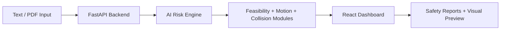

# AstraVision

AstraVision is an AI-based production safety and feasibility platform for evaluating scene risk before filming begins. It combines scene analysis, motion modeling, collision detection, and crew guidance into one decision-making dashboard.

## Product overview

- Scene safety scoring from raw text or uploaded PDF script
- Role-based risk identification for actors, camera crew, technicians, and the director
- Safety instructions tailored to each department
- Motion path analysis and collision checking
- Visual scene preview generation for concept review

## System architecture

The system is organized into four layers:

1. Input layer: text input and PDF script upload
2. AI analysis layer: Groq-powered scene reasoning and risk extraction
3. Decision engine: feasibility logic, motion modeling, and collision detection
4. Output layer: dashboard analytics, risk summaries, and generated previews



## Project structure

```text
AI-based-feasibility-and-risk-predictor/
├── backend/
│   ├── api/
│   ├── app/
│   ├── engine/
│   ├── schema/
│   ├── utils/
│   └── test_ai.py
├── frontend/
│   ├── src/
│   ├── package.json
│   └── vite.config.js
├── README.md
└── .gitignore
```

## Local setup

### Backend

```bash
cd backend
python -m venv .venv
source .venv/bin/activate   # Windows: .venv\Scripts\activate
pip install fastapi uvicorn python-multipart openai python-dotenv pydantic
uvicorn app.main:app --reload --host 0.0.0.0 --port 8000
```

### Frontend

```bash
cd frontend
npm install
npm run dev
```

### API configuration

Set the AI key used by the backend before running analysis:

```bash
export GROQ_API_KEY=your_key_here
```

## Core features

- Script-driven scene risk review
- Crew-specific safety instructions
- Feasibility decisioning
- Motion path collision detection
- Modern UI dashboard for production teams

## Notes

This project is designed to be a production-facing prototype and is structured so each feature area can evolve independently without disturbing the rest of the system.
